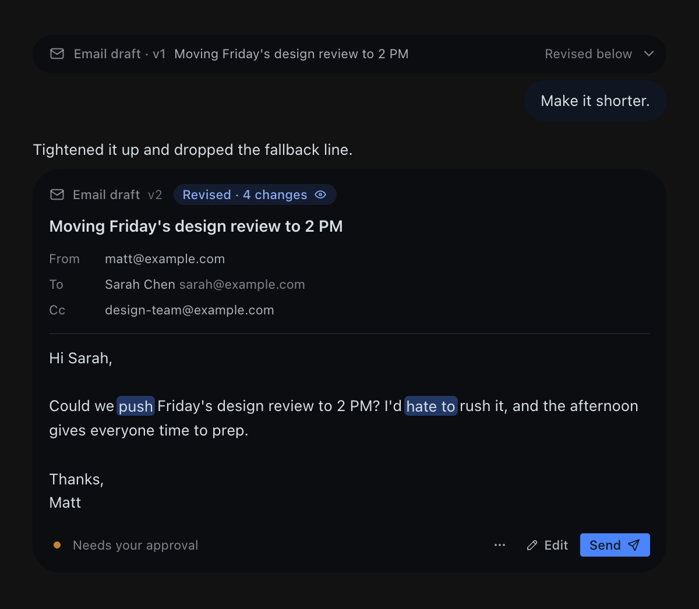
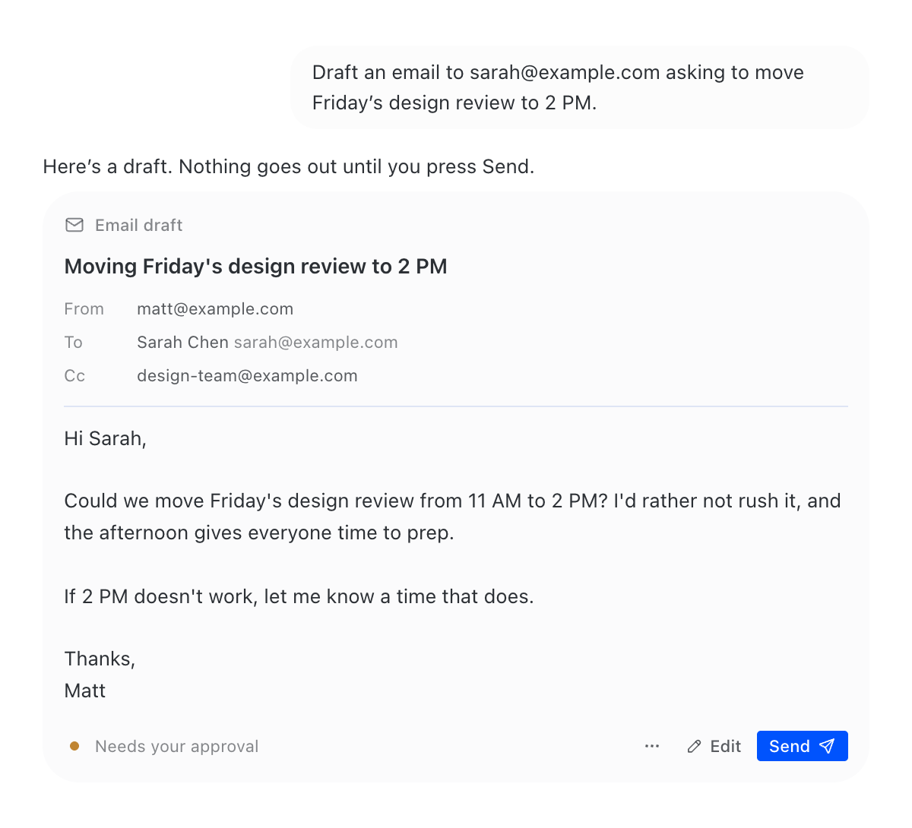
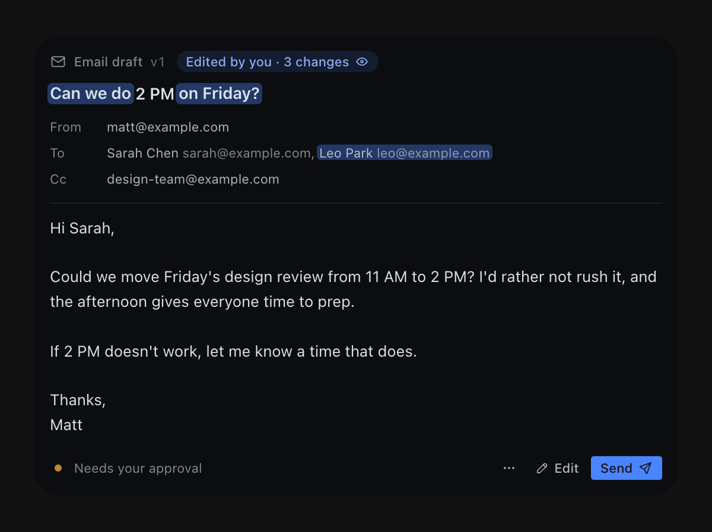
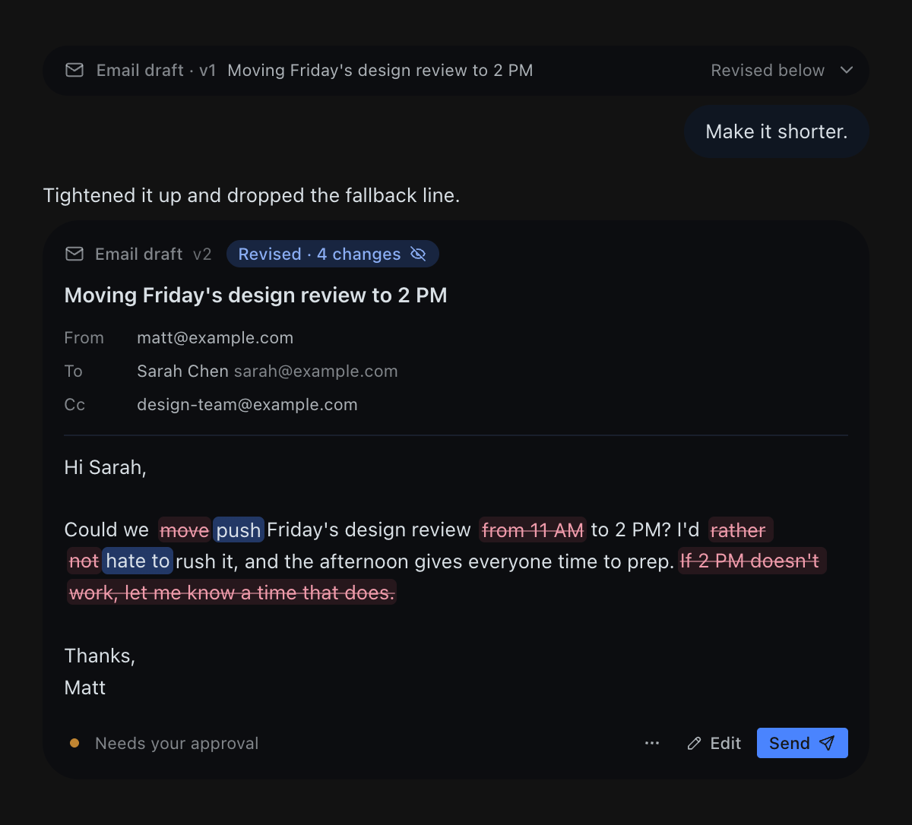

# Draft Cards for Hermes

Email and chat-message drafts as **reviewable cards** in the Hermes desktop chat.

Ask Hermes to write an email and it shows a card instead of a wall of text: recipients,
subject and body, ready to read. Ask for a change and the next card **highlights exactly
which words changed**. Edit it yourself right in the card. Nothing is sent until you press
**Send**.



## What you get

- **A real draft, not a code block.** From, To, Cc, Bcc, subject and body, set in the app's
  own type and colours. Works for email and for chat messages (Slack, Telegram, iMessage,
  X DMs…).
- **Revisions you can read at a glance.** Every revision opens a new card with the changed
  words highlighted; the earlier card folds into a one-line row above it. Tap the
  "Revised · 3 changes" pill to also see what was removed.
- **Inline editing.** Press Edit, change anything, press ⌘↵. Your edit becomes a new version
  ("Edited by you"), and Hermes sends your words, not its own.
- **Approval first.** Send records your approval of that exact version, then hands it to
  Hermes to send with whatever mail or messaging tool you already use. The card follows it
  through: Approved → Sent via Gmail · 2:14 PM, or Couldn't send, with Try again.
- **Works without any mail setup.** Copy text, or Open in Mail (a `mailto:` link to your
  default mail app).
- Light and dark themes, every Hermes skin, reduced motion, narrow panes.

| Light | Edited by you | Removed text shown |
| --- | --- | --- |
|  |  |  |

## Install

```bash
hermes plugins install arsiktech/hermes-draft-cards --enable
```

Then open **Capabilities → Plugins** in the desktop app and switch on the **Draft Cards**
desktop half (Hermes ships desktop halves off until you opt in). Start a new chat so the
agent sees the new tools.

Requires Hermes 0.22.2 or newer.

## How it works

```
you: "Draft an email to Sarah moving Friday's review to 2 PM"
  └─ agent calls draft_card(...)          → draft saved locally, version 1
  └─ agent replies with ::draft-card{…}   → the desktop renders the card
you: "Make it shorter"
  └─ agent calls draft_card(draft_id, …)  → version 2, new card, changes highlighted
you: press Send on the card
  └─ the card records your approval of version 2 and posts
     "Approved: send … (Draft d_…, version 2)" to the chat
  └─ agent calls draft_card_read, sends that exact text with its own mail tool,
     then draft_card_status(sent, "via Gmail")  → the card shows Sent
```

The plugin has three parts in one folder:

| Part | File | Job |
| --- | --- | --- |
| Agent tools | `__init__.py`, `tools.py`, `store.py` | `draft_card`, `draft_card_read`, `draft_card_status` |
| Backend | `dashboard/plugin_api.py` | Serves drafts to the card; saves your inline edits, approvals and discards |
| Desktop card | `desktop/plugin.js` | The `::draft-card{id="…" v="…"}` transcript directive |

On surfaces without the desktop app (terminal, Telegram, Slack…), the tool also returns a
plain-text version of the draft, and the agent shows that instead.

## Privacy and behaviour

- **No network calls.** The plugin never contacts any service. Sending is done by the
  agent's existing tools, only after your approval.
- **No credentials.** The plugin reads no tokens, keys or mail accounts.
- **Local storage.** Drafts (recipients, subject, body, versions) are stored in this
  profile's `plugin-data/draft-cards/drafts.db`. The 500 most recent drafts are kept.
- **No shell commands, no background processes, no telemetry.**
- The desktop half adds one stylesheet for the card and is removed cleanly when you disable
  the plugin.

## Development

```bash
python -m pytest -c tests/pytest.ini     # store, tools and backend routes
hermes plugins validate .                # the catalog's admission checks
```

For a live loop, link the checkout: `ln -s "$PWD" ~/.hermes/plugins/draft-cards`.

## License

MIT
